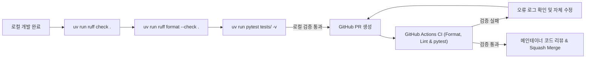

# 협업, 브랜치 전략 및 커밋 컨벤션 가이드 (CONTRIBUTING.md)

본 문서는 `busan-metro-congestion` 프로젝트의 협업 원칙, 브랜치 전략, 커밋 컨벤션 및 PR 승인 규칙을 정의합니다. 모든 기여자와 AI 에이전트는 본 가이드를 준수해야 합니다.

---

## 1. 기본 기여 원칙

* 모듈별 오너십 준수:
  * 전처리 파트 (데이터 엔지니어링): `busan_metro_congestion/preprocess/` 수정
  * 모델링 파트 (ML/DL 엔지니어링): `busan_metro_congestion/modeling/` 수정
  * 핵심 모듈·컨테이너(`busan_metro_congestion/config.py`, `busan_metro_congestion/run_pipeline.py`, `docker/`) 및 의존성·빌드·CI 설정(`pyproject.toml`, `uv.lock`, `.github/workflows/ci.yml`): 메인테이너 사전 승인 후 수정
* 메인 로직과 서브 로직 구분:
  * 메인 로직 (`track:main`): 데이터 수집 자동화 이후 정기 배치로 실행되는 운영 경로입니다. `busan_metro_congestion/` 패키지 전체(`preprocess/`, `modeling/`, `config.py`, `run_pipeline.py`), `scripts/fetch_*.py`, `scripts/build_*.py`가 해당합니다.
  * 서브 로직 (`track:research`): 논문 실험, 피처 그룹 소거 실험(Ablation) 및 하이퍼파라미터 튜닝을 위한 연구 경로입니다. `scripts/run_optuna_2track_ablation.py`, `artifacts/ablation/`이 해당합니다.
  * 의존성 방향: 서브 로직은 메인 로직 패키지를 가져다 쓰지만, 메인 로직 패키지는 서브 로직을 import하지 않습니다.
* 데이터·가중치 및 비밀키 격리:
  * 대용량 원본 및 생성 데이터(`data/raw/**`, `data/interim/**`, `data/features/**`, `data/processed/**`), 모델 가중치·스케일러·Optuna DB 등 체크포인트(`artifacts/**/checkpoints/**`, `artifacts/**/*.{pt,pth,bin,joblib,onnx}`), API 인증키 파일(`.env`)은 Git에 커밋하지 않습니다.
  * 테스트용 미니 샘플(`data/samples/`)과 참고 자료 데이터(`data/reference/`)만 Git 추적이 허용되며, 평가 리포트(JSON/Markdown)는 각 실험 폴더(`artifacts/baseline/`, `artifacts/ablation/`)에 관리합니다.

---

## 2. 브랜치 전략 (GitHub Flow 기반)

* `main` 브랜치:
  * 상시 배포 및 배치 실행이 가능한 상태를 유지하는 기본 기준선 브랜치입니다.
  * 직접적인 `git push`는 제한되며, 오직 PR(Pull Request)을 통해서만 반영됩니다.
  * 예외: 저장소 초기 구성 시 프로젝트 뼈대 커밋과 공통 기반 커밋(전역 설정, CI)은 메인테이너가 `main`에 직접 커밋합니다. 기반 커밋을 푸시한 직후 `main` 보호 규칙(PR 필수, CI 통과 필수)을 적용합니다.
* 작업 브랜치 명명 규칙:
  * `feat/<기능명>`: 새로운 기능 및 파이프라인 모듈 개발 (예: `feat/preprocess`, `feat/modeling`, `feat/sample-generator`)
  * `fix/<수정내용>`: 버그 및 오류 수정 (예: `fix/schema-null-error`)
  * `docs/<문서명>`: 문서 추가 및 수정 (예: `docs/readme-update`)
  * `refactor/<대상>`: 기능 변경 없는 코드 구조 개선 (예: `refactor/import-cleanup`)
* 브랜치 수명 주기 (Lifecycle):
  0. **이슈 등록 (Issue)**: 작업 단위마다 `.github/ISSUE_TEMPLATE/`(`feat.md`, `fix.md`, `docs_chore.md`) 템플릿으로 GitHub Issue를 먼저 등록하고 트랙 라벨(`track:main` / `track:research`)과 영역 라벨(`area:preprocess`, `area:modeling`, `area:data`, `area:api`, `area:ui`, `area:ops`, `area:ci`, `area:docs`)을 지정합니다. 1개 이슈는 1개 브랜치·1개 PR에 대응합니다.
  1. **분기 (Creation)**: 최신 `main` 브랜치에서 분기합니다 (`git checkout -b <브랜치명>`).
  2. **로컬 개발 및 검증 (Development & Local Gate)**: 작업 중 변경 사항에 대해 로컬 린트 및 포맷 검증(`uv run ruff check .`, `uv run ruff format --check .`)을 반드시 통과합니다 (단위 테스트가 작성된 경우 `uv run pytest tests/ -v` 포함).
  3. **원격 푸시 및 CI (Push & CI Gate)**: 원격 저장소에 푸시하여 GitHub Actions CI 자동 검사를 통과합니다.
  4. **PR 생성 및 리뷰 (Pull Request)**: `.github/pull_request_template.md` 체크리스트에 따라 `main`을 대상으로 PR을 생성하고 코드 변경 사항을 검토합니다. PR 본문에 `Closes #<이슈 번호>`를 적어 병합 시 이슈가 자동으로 닫히게 합니다.
  5. **병합 및 종료 (Squash & Merge & Deletion)**: PR 승인 시 1개의 원자적 커밋으로 Squash & Merge를 수행하며, 병합 완료 즉시 작업 브랜치는 원격과 로컬에서 삭제하여 브랜치 목록을 청결하게 유지합니다.
* 테스트 코드 원칙:
  * 모듈별 단위 테스트는 해당 기능 구현 브랜치(`feat/<기능명>`)에서 기능 코드와 함께 작성합니다. 미구현 상태의 빈 테스트를 `main` 브랜치에 미리 커밋하여 스킵 처리하지 않습니다.
  * 단위 테스트는 외부 OpenAPI 실호출 없이 오프라인 모킹과 Git 추적 데이터(`data/samples/`, `data/reference/`)만 사용하며, 형식적·항진 명제 테스트 대신 핵심 불변식·경계 조건·실패 경로를 검증합니다.
  * 각 커밋에는 그 시점에 추적되는 파일만으로 통과하는 테스트만 포함합니다. 아직 커밋되지 않은 모듈이나 데이터에 의존하는 테스트는 해당 모듈과 같은 PR에 포함합니다.
  * 추적되지 않은 파일은 브랜치를 전환해도 작업 트리에 남으므로, 로컬 테스트가 커밋되지 않은 파일 덕분에 통과할 수 있습니다. PR 전에는 `git worktree add <짧은 경로> <브랜치>`로 만든 깨끗한 체크아웃에서 테스트를 실행합니다 (Windows 경로 길이 제한을 피하기 위해 짧은 경로를 사용합니다).
* 줄바꿈 규칙:
  * `.gitattributes`에 따라 텍스트 파일은 LF로 통일되며, `data/` 하위 파일은 원천 인코딩과 줄바꿈을 바이트 그대로 유지합니다.

---

## 3. 커밋 컨벤션 (Conventional Commits)

작업 영역은 브랜치로 분리되므로, 스코프(Scope) 없이 직관적인 `태그: 한글 제목` 형식을 사용합니다.

```text
태그: 한글 간결한 제목

[선택사항] 한글 상세 설명 본문 (무엇을, 왜 변경했는가)
```

### 3.1 태그 (Tag)
* `feat`: 새로운 기능 추가
* `fix`: 버그 및 오류 수정
* `docs`: 문서 추가 및 수정
* `refactor`: 기능 변경 없는 코드 리팩토링 및 구조 개선
* `test`: 테스트 코드 추가 및 수정
* `chore`: 빌드 설정, 의존성 패키지 변경, 환경 설정 등

### 3.2 50/72 규칙 및 작성 예시
* 제목은 50자 내외의 명확한 한글로 작성하며 끝에 마침표를 찍지 않습니다.
* 제목과 본문 사이에는 반드시 빈 줄을 둡니다.
* 본문은 한 줄당 72자를 넘지 않도록 줄바꿈합니다.

**작성 예시**:
```text
feat: 전 노선 역간 누적 승객 시뮬레이션 알고리즘 구현

- 역간 누적 승객 수식(P_t = P_t-1 + In - Out) 적용
- 기점역부터 종점역까지의 누적 승객수 및 혼잡도(%) 계산
- 1호선 공식 데이터를 통한 상관계수 교차 검증
```

---

## 4. PR 거버넌스 및 CI 검증 원칙

안정적인 코드 통합과 품질 유지를 위해 자동 검증 절차를 거칩니다.



### 4.1 PR 제출 전 필수 로컬 검사
PR을 생성하기 전에 로컬 터미널에서 다음 명령어를 실행하여 통과해야 합니다:
```bash
# 1. 코드 스타일 및 린터 검사
uv run ruff check .
uv run ruff format --check .

# 2. 단위 테스트 검증
uv run pytest tests/ -v
```

### 4.2 CI 검증 원칙
CI(`.github/workflows/ci.yml`)는 `lint` 잡(`Lint & Format (Ruff)`: `ruff format --check`, `ruff check`)과 `test` 잡(`Unit Tests (pytest)`: `pytest tests/`)을 병렬 실행합니다.

1. GitHub Actions CI 테스트를 통과하지 않은 PR은 리뷰 및 머지를 진행하지 않습니다.
2. CI 실패 시, 테스트 로그를 확인하여 오류를 수정한 후 재푸시해야 합니다.

### 4.3 병합 전략 (Merge Strategy)
* Squash & Merge 전용:
  * 저장소 설정으로 Squash & Merge만 허용하며, PR의 작업 커밋들을 1개의 원자적(Atomic) 커밋으로 압축해 `main` 브랜치에 병합합니다.
  * 머지 완료 시 원격 작업 브랜치는 자동 삭제되며, `main` 브랜치의 force push 및 삭제는 보호 규칙으로 차단됩니다.
